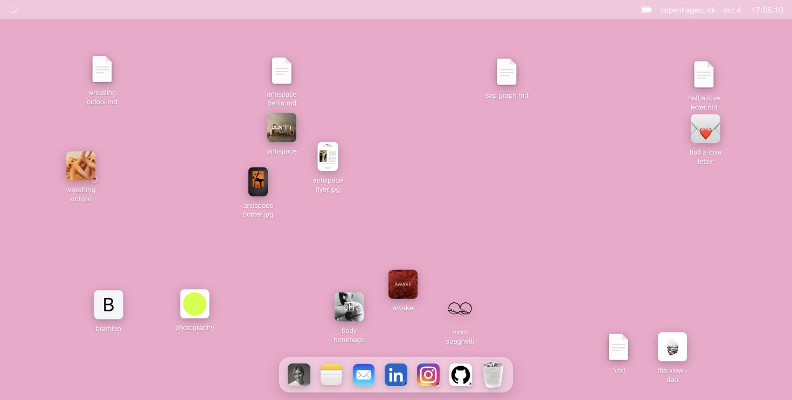

# Half Odd

The website and portfolio for **Half Odd**, my independent design and technology practice.

Half Odd is where I work across digital products, visual identities, websites, and software - often taking projects from an early idea through design, implementation, and launch.

The site itself is designed as a small desktop environment rather than a conventional portfolio. Projects live as files, documents, images, and applications that can be opened, moved, minimized, and explored.

## Selected work

The portfolio includes case studies for:

- **Wrestling Octopi** - 0→1 product design and software engineering
- **Antispace Berlin** - brand extension, print, UX/UI, and Framer development
- **SAP Graph** - front-end engineering and design systems
- **Half a Love Letter** - interaction design, AI experimentation, and development

Alongside the case studies are smaller client projects, visual work, photography, and experiments.

## Design approach

The interface borrows the familiarity of a desktop operating system while keeping the portfolio itself deliberately simple.

Desktop interactions include:

- draggable files and applications
- multiple windows
- window focus, minimize, maximize, and close states
- persistent desktop layouts
- internal documents and image previews
- external applications and links
- a functional dock and trash system

On smaller screens, the same work is reorganized into a simpler mobile-first file browser.

## Built with

- React
- TypeScript
- Vite
- CSS Modules and native CSS animations
- Marked for Markdown rendering
- Oxlint for linting

## Overlay links

Append a hash suffix to the site URL to open an overlay directly, for example
`https://www.halfodd.com/#wrestling-octopi-case-study` or `https://www.halfodd.com/#cv`.
Opening or focusing an overlay updates the address bar; copy that URL to share it.
Links work on desktop and mobile, including reloads and hash navigation.
Closing an overlay updates the URL to the next active window, or removes the suffix.
Unknown or malformed suffixes are ignored. Audio and external-link icons have no desktop overlay.

Available overlay suffixes:

- `#body-hommage`
- `#smiley-txt`
- `#mom-spaghetti`
- `#antispace-poster`
- `#antispace`
- `#awake`
- `#antispace-flyer`
- `#half-a-love-letter`
- `#bramlen`
- `#antispace-berlin-case-study`
- `#half-a-love-letter-case-study`
- `#sap-graph-case-study`
- `#wrestling-octopi-case-study`
- `#photo-portfolio`
- `#cv`
- `#about-me`
- `#notes`
- `#mail`
- `#trash`
- `#body-hommage-logo`

`#about` also works as an alias for `#about-me`.

## Live

[halfodd.com](https://www.halfodd.com/)

## About

Designed and built by [Theresa Schantz](https://www.halfodd.com/).

Designer & software engineer working across digital products, interfaces, visual identities, and technology.

## License

All rights reserved. See [LICENSE](LICENSE).
